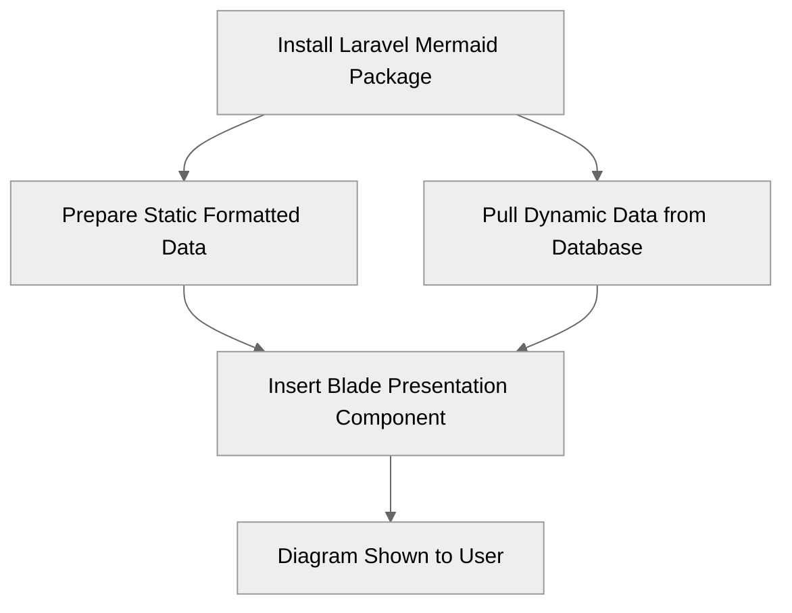
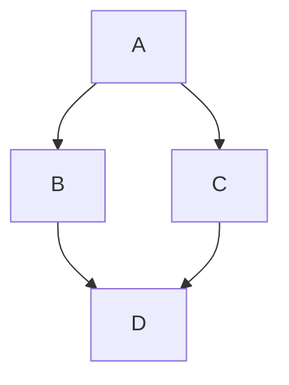
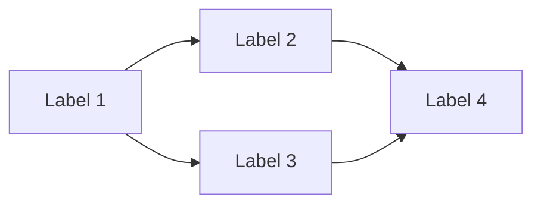
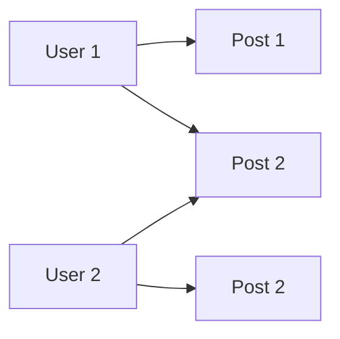
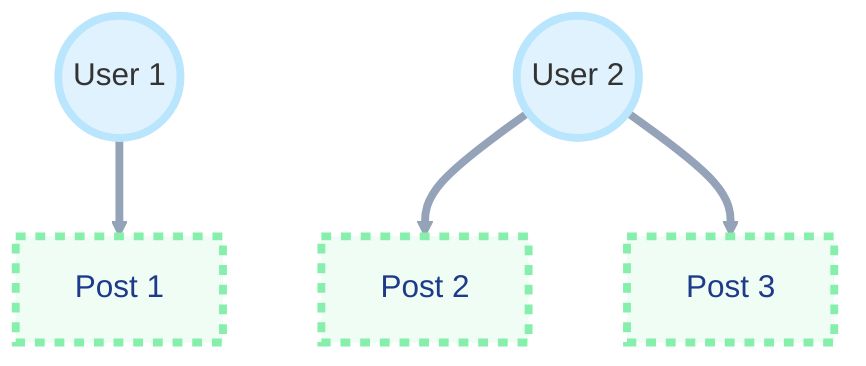

# laravel-mermaid
Simple Mermaid diagrams for Laravel applications. Laravel Mermaid generates flowcharts, user journeys, entity relationship diagrams, business process diagrams, mind maps, and the other diagram types supported by Mermaid 11.

The current release supports PHP 8.2+ and Laravel 12 or 13.

## Mermaid Diagrams
Mermaid is a diagramming and charting library with a Markdown-like syntax for generating data visualisations. Mermaid diagrams are also supported in GitHub Markdown and Notion, making the syntax familiar to many users.


You can find out more in the [Mermaid documentation](https://mermaid.js.org).

## Installation

You can install the package via composer:

```bash
composer require icehouse-ventures/laravel-mermaid
```

## Quickstart: Blade Component Slot
The package provides a Blade component that you can use to generate Mermaid diagrams in your views. Here is an example of how you can use the Blade component to generate a simple flowchart diagram. The component can be wrapped around any standard Mermaid diagram string (similar to Markdown strings).

```php
<x-mermaid::component>
    graph TD;
        A-->B;
        A-->C;
        B-->D;
        C-->D;
</x-mermaid::component>
```

## Passing Mermaid syntax to the Blade component
You can pass a Mermaid diagram string directly to the component using the `data` attribute.

```php
// In your controller
public function index()
{
    $data = 
        'graph LR;
            A[Label 1];
            A-->B;
            A-->C;
            B[Label 2];
            B-->D;
            C[Label 3];
            C-->D;
            D[Label 4];';

    return view('your-view', compact('data'));
}

// Your page blade file
<x-mermaid::component :data="$data" />
```



## Passing an Array to the Blade Component
Laravel and PHP provide convenient helpers for working with arrays. The builder converts an array of Mermaid statements into a diagram string:

```php
// In your controller
use IcehouseVentures\LaravelMermaid\Facades\Mermaid;

public function index()
{
    $data = [
        'A-->B',
        'A-->C',
        'B-->D',
        'C-->D'
    ];

    $data = Mermaid::build()->generateDiagramFromArray($data);

    return view('your-view', compact('data'));
}

// Your page blade file
<x-mermaid::component :data="$data" />
```


## Passing in an Eloquent Collection
You can also pass in an Eloquent collection to the Blade component. This allows you to visualise complex business data and relationships straight from your Eloquent models and their relationships. The package will automatically convert the collection to an array of strings that represent the Mermaid diagram using the Generate Diagram From Collection method. Here is an example of how you can pass an Eloquent collection to the Blade component:

```php
// In your controller
use IcehouseVentures\LaravelMermaid\Facades\Mermaid;

public function index()
{
    $collection = User::with('posts')->get();
    
    $data = Mermaid::build()->generateDiagramFromCollection($collection);
    
    return view('your-view', compact('data'));
}

// Your page blade file
<x-mermaid::component :data="$data" />
```


## Custom collections, models and relationships
You can also pass in custom collections, models and relationships to the Blade component by flattening the data into an array, then using the array method in the package to generate the diagram. This method is useful if you want more complex dynamic data such as links or custom formatting.


```php
use IcehouseVentures\LaravelMermaid\Facades\Mermaid;

$users = User::with('posts')->take(3)->get();

$data = [];
$data[] = "classDef user fill:#e0f2fe,stroke:#bae6fd,stroke-width:4px";
$data[] = "classDef post fill:#f0fdf4,stroke:#86efac,stroke-width:4px,color:#1e3a8a,stroke-dasharray: 5 5";

foreach ($users as $user) {
    $data[] = "U{$user->id}(({$user->name}))";

    foreach ($user->posts as $post) {
        $data[] = "P{$post->id}[{$post->title}]";
        $data[] = "U{$user->id} --> P{$post->id}";
    }
}

$data[] = "class U1,U2 user";
$data[] = "class P1,P2,P3 post";
$data[] = "linkStyle default stroke:#94a3b8,stroke-width:4px";

$data = Mermaid::build()->generateDiagramFromArray($data);
```




## Configuration
You can customize the Mermaid configuration by publishing the `mermaid.php` config file and changing the settings as needed. You can publish the configuration file using the following command:

```bash
php artisan vendor:publish --provider="IcehouseVentures\LaravelMermaid\ServiceProvider" --tag="config"
```

This creates `config/mermaid.php`. Set `theme` to `default`, `forest`, `dark`, `neutral`, `base`, or `custom`.

By default the package uses its Tailwind-inspired custom theme. When `theme` is `custom`, select `bootstrap`, `tailwind`, or `darkmode` with `themeFile`.

The bundled browser runtime is pinned to Mermaid major version 11:

```php
'cdn' => 'https://cdn.jsdelivr.net/npm/mermaid@11/dist/mermaid.min.js',
'securityLevel' => 'strict',
```

You can replace `cdn` with an exact version, a self-hosted asset, or an approved internal CDN. Keep `securityLevel` set to `strict` unless every diagram and HTML label is trusted.

## Canvas Style
You can also set the canvas style for the Mermaid diagram by passing in a class to the Blade component. This allows you to style the diagram using your own CSS. 

```php
<x-mermaid::component :data="$data" class="border rounded p-2" />
```

## Livewire
This package includes a Livewire-compatible component that re-renders a diagram
when a component property changes. The current release and demo application are
tested with Livewire 4. In this example, increasing the `limit` loads more users
into the diagram.

```php

// Your Livewire Class:
<?php

namespace App\Livewire;

use App\Models\User;
use Livewire\Component;
use IcehouseVentures\LaravelMermaid\Facades\Mermaid;

class MermaidDiagram extends Component
{
    public $limit = 2;

    public $mermaid;

    public function render()
    {
        $this->mermaid = Mermaid::build()->generateDiagramFromCollection(
            User::with('posts')->limit($this->limit)->get()
        );

        return view('livewire.mermaid');
    }
}

// Your Livewire View:
<div>
    <x-mermaid::livewire-component wire:model="mermaid" />

    <div>
        <label for="limit">Limit:</label>
        <input wire:model.live="limit" id="limit" type="number">
    </div>
</div>
```


## Background
Icehouse Ventures created this package for dynamic diagrams in Laravel and now
maintains it with its community of contributors.

## Contributing

Contributions from first-time and returning contributors are welcome. Bug
reproductions, new diagram examples, documentation fixes, tests, accessibility
improvements, and compatibility updates are all useful. Open an issue for a
design discussion or send a focused pull request for a well-understood change.

## Development

```bash
composer install
composer check
```

`composer check` runs Pint, PHPStan and the Pest test suite. GitHub Actions exercises Laravel 12–13 across PHP 8.2–8.5.

## License

The MIT License (MIT). Please see [License File](LICENSE.md) for more information.
